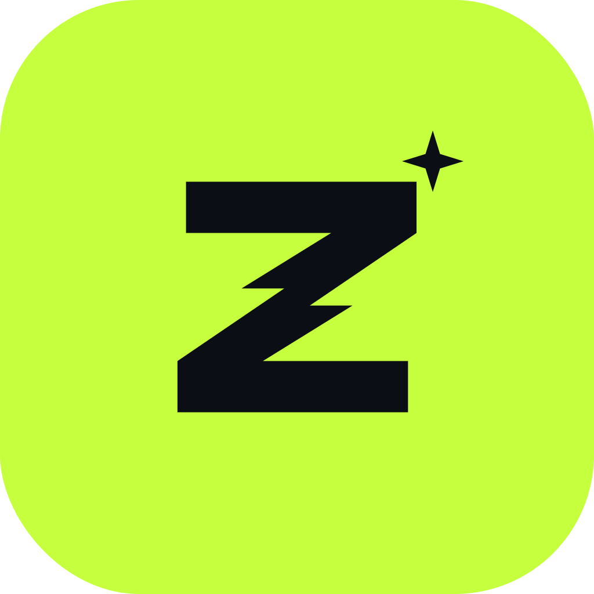

<p align="center">
  
</p>

<h1 align="center">superzed</h1>

<p align="center">
  <b>Run a dozen Claude Code sessions without losing track of any of them.</b><br>
  An infinite canvas for your chats, a kanban that moves them for you, and every account's quota in one place. Built on <a href="https://zed.dev">Zed</a>.
</p>

<p align="center">
  <a href="../../releases/latest">Download</a> ·
  <a href="#features">Features</a> ·
  <a href="#shortcuts">Shortcuts</a> ·
  <a href="#setup">Setup</a>
</p>

<p align="center">
  
</p>

---

Once you have more than three Claude Code chats going, terminal tabs stop working. One chat is waiting on a question, another finished ten minutes ago with uncommitted files, a third is about to hit the 5-hour limit, and you can't see any of it.

superzed puts every chat on a **canvas** next to your code. It **files them by phase** as they go from brainstorming to plan to implementation, **taps you on the shoulder** when one needs you, and **starts each new chat on the account with the most quota left**.

## Features

### A canvas for chats, shells and notes

Every project tab gets its own zoomable canvas beside the editor. Claude chats, terminals, sticky notes, data panels and automations are all nodes you can drag, resize and group. Zoom out and each chat becomes a card that shows its title, its state and how long ago it last replied. Everything is saved in `.superzed/project.json` and comes back when you reopen the project, with every chat resumed.

- **Project tabs** in the title bar, with colors and names. A bell appears on a tab when a chat inside it needs you.
- `cmd-j` / `cmd-e` jump between the canvas and the editor, and `cmd-↑↓←→` move between chats.
- **Golden chats** (`cmd-g`) get a star and stay pinned at the top of the Sessions list.

### A kanban that moves chats for you

<p align="center"></p>

Drop a chat into the kanban and it follows its own progress. When Claude runs the [superpowers](https://github.com/obra/superpowers) skills (brainstorming, writing a spec, writing a plan, executing it, finishing the branch), the card moves to the matching column automatically. **Others** and **Analysis** are yours to fill by hand. `/clear` sends a chat back to **New**.

### Never miss a chat that needs you

- A chat waiting for an answer **pulses amber** on the canvas, in the Sessions sidebar and on its project tab.
- Working chats show a cyan **Working** pill. Chats that finished show how many files they **left uncommitted**.
- **Sort the Sessions list by priority** to see first whatever needs you, across every open project.
- **Commit & close**: closing a chat with uncommitted changes offers to let Claude commit them first.
- `cmd-shift-w` offers to **close every idle chat** in the project and keeps the golden and recently active ones.

### Many Claude accounts, one scheduler

<p align="center"></p>

Register as many Claude accounts as you have and superzed reads their quotas straight from Claude (tokens stay in the macOS Keychain). `cmd-n` starts a chat on the account that can best afford it, judging by weekly quota left, how close the reset is, the 5-hour window and how many chats are already running there. `cmd-shift-n` lets you pick the account yourself.

- **Limits** in the sidebar and the status bar show what is left and when it resets, yellow under 20% and red under 10%.
- **Keep an account out of a folder**: right-click it in Limits so it is never auto-picked there.
- Logged-out accounts show **Login needed** with a button that opens a chat to log in.

### From "done" to GitHub, with a review step

<p align="center"></p>

When a kanban chat reaches **Done**, superzed asks Claude for a short report: which issues it touched, which new issues it found, and a summary. You review everything in one dialog and edit titles and comments as needed. Nothing reaches GitHub until you press **Write to GitHub**.

### Notifications Claude can raise

Every chat has `superzed-notify` on its `PATH`, so Claude (or a script, or an automation) can raise a notification with a severity, a summary and details. **Resolve** opens a new chat in the kanban that already knows what the notification is about.

### Automations

Schedule a prompt to run every morning, every few hours or once a week, in its own docked chat and on the account you pick (or the best one available). You can pause an automation, run it now or edit it. It waits for its chat to be free before starting.

### Prompt library

`cmd-shift-m` opens your saved prompts: Markdown files with placeholders, global or per project (`.superzed/prompts`). Pick one and a fresh chat starts with it.

### Sources: your production data next to the chat

Pin live panels on the canvas, such as **GitHub** issues and project boards, **HyperDX / ClickHouse** logs reached through a managed SSH tunnel (read-only), or **Zabbix** problems. Filter them, and start a chat from any row with the details already attached.

## Shortcuts

Hold `cmd` for a moment to see all of them.

| | |
|---|---|
| `cmd-n` | New chat on the best account |
| `cmd-shift-n` | New chat, choose the account |
| `cmd-shift-m` | New chat from the prompt library |
| `cmd-t` · `cmd-alt-n` | New terminal · new note |
| `cmd-alt-k` | Open the kanban |
| `cmd-shift-←/→` | Move the chat to the previous / next column |
| `cmd-g` | Mark a chat golden |
| `cmd-shift-w` | Close idle chats |
| `cmd-1` … `cmd-6` | Files, Git, Sessions, Search, Notifications, Sources |
| `ctrl-1` … `ctrl-9` · `ctrl-tab` | Switch project tab |
| `cmd-+` / `cmd--` / `cmd-0` | Zoom the canvas |

## Setup

**Download** the latest build from [Releases](../../releases/latest): macOS (Apple silicon) `.dmg` or Linux x86_64 `.tar.gz`.

You will need:

- [Claude Code](https://docs.anthropic.com/en/docs/claude-code) on your `PATH`.
- Optionally, the [superpowers](https://github.com/obra/superpowers) plugin, so the kanban can follow phases automatically.
- Optionally, the [`gh`](https://cli.github.com) CLI, logged in, for the GitHub source and Done → GitHub.

**Accounts** live in `~/.config/superzed/accounts.json`. On first launch they are imported from nodeterm if you use it. Otherwise list them yourself:

```json
{
  "version": 1,
  "scheduler": "weekly",
  "accounts": [
    { "id": "work", "label": "work", "email": "dev@northwind.example",
      "config_dir": "/Users/you/.claude-accounts/work" },
    { "id": "client", "label": "client-lab", "email": "ops@client-lab.example",
      "config_dir": "/Users/you/.claude-accounts/client", "exclude_from": ["~/code/personal"] }
  ]
}
```

`config_dir` is the account's `CLAUDE_CONFIG_DIR`, written as an absolute path. `scheduler` can be `weekly` (the default), `headroom` or `session`. Your regular `~/.claude` login is always available as the system account.

### Build from source

superzed builds like Zed. See [Building Zed for macOS](./docs/src/development/macos.md) or [Linux](./docs/src/development/linux.md), then:

```sh
script/bundle-mac -i       # first install into /Applications/superzed.app
script/superzed-install    # later: rebuild just the binaries, incrementally
```

## Credits and license

superzed is a fork of [Zed](https://github.com/zed-industries/zed) by Zed Industries, the high-performance editor from the creators of Atom and Tree-sitter. All the editing you love comes from them. The canvas, sessions, accounts and everything above were added on top.

Source code is licensed primarily under GPL-3.0-or-later, with Apache-2.0 components where marked. Third-party license information is generated with [`cargo-about`](https://github.com/EmbarkStudios/cargo-about); see `script/licenses/zed-licenses.toml`.
